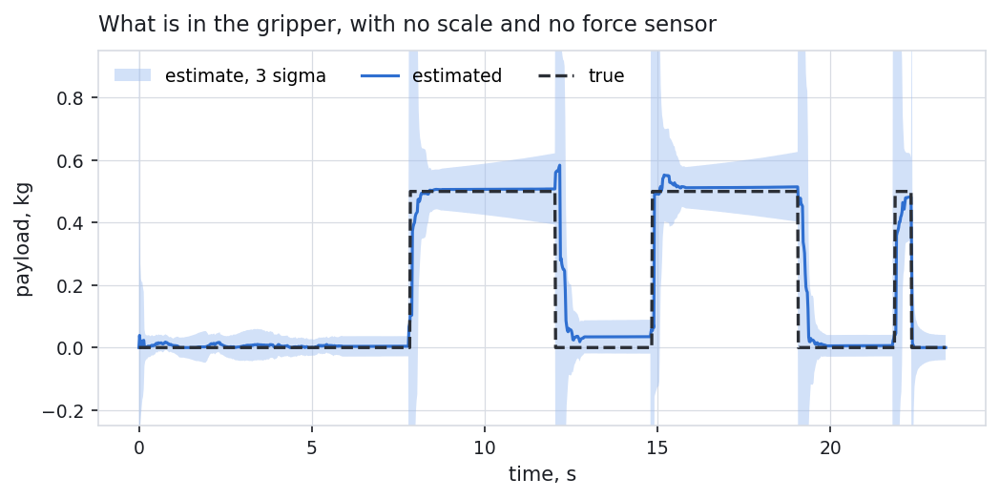
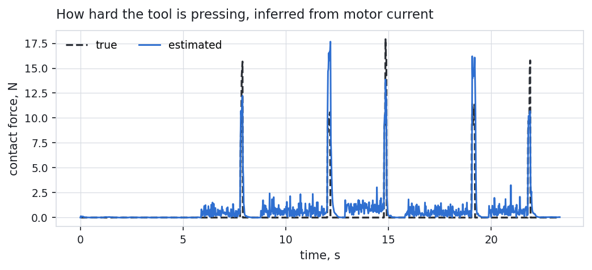
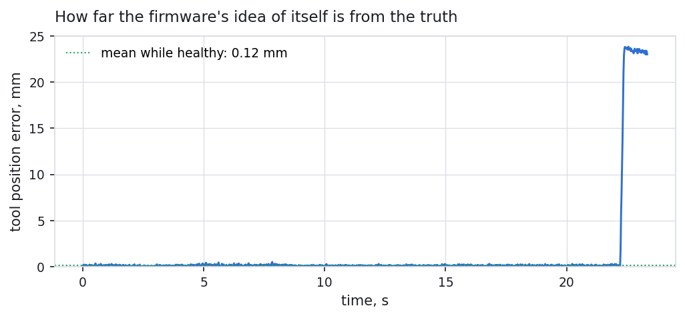
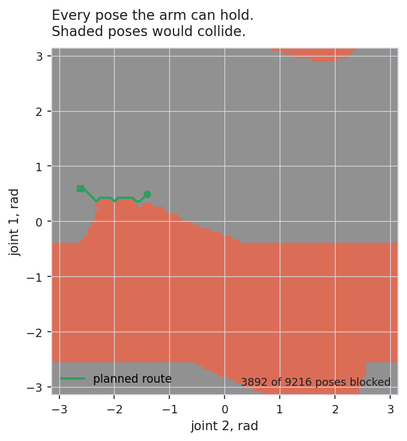

# PPA-100: pick and place arm

Firmware for a two joint robot arm that picks boxes off a table and puts them
where it is told, developed against a simulated cell. It has no scale and no
force sensor, so it works out what it is carrying and how hard it is pressing
from motor current and a model of itself.

Everything runs in simulation. No hardware is required, and nothing needs
installing beyond a C++ compiler and Python.

## Live 3D replay

**[Open the interactive replay](https://karishmapremnath4.github.io/robotic-pick-place-arm/data/viewer.html)**

Drag to orbit, scroll to zoom, press play. The solid arm is where the arm really
is; the ghost arm is where the firmware believes it is from its own sensors. They
separate when a sensor is frozen, which is the point of showing both.

## What it does

```
> survey
  survey done, 99% of the table seen, 3 objects
    object 1 at x 0.180, top -0.112 m, 50 mm wide
    object 2 at x 0.260, top -0.109 m, 50 mm wide
    object 3 at x 0.340, top -0.110 m, 50 mm wide

> job 0.26 0.12
  >> [  2.18s] contact found
  >> [  2.55s] grip confirmed
  >> [  6.81s] placed

> inject enc stuck 1
  joint 1 encoder frozen
  >> [ 19.94s] BOX DROPPED IN TRANSIT
  >> [ 19.94s] safety DEGRADED (sensor faulted)
```

It finds the boxes itself with a laser sweep rather than being given
coordinates. It feels for the box top rather than being told its height. It
weighs what it picked up to check the pick worked. It notices a box falling
off mid move. And when a sensor starts lying it works out which one, drops it,
and keeps going on the other.

## Results

Every figure below plots the firmware's estimate against the truth the
simulation knows and the firmware does not. A plot of an estimate on its own
shows a smooth line and proves nothing.









### The numbers, and where each came from

| Measurement | Result | Source |
|---|---|---|
| payload mass, settled | 11 g mean, 51 g worst | `tools/plots.py` over `build/record`, 89% of carry time |
| payload mass, including the grip transient | 22 g mean, 460 g worst | same run; the worst case is the instant the jaws close, before the filter has seen any evidence |
| payload mass, in a controlled sweep | 1 to 4 g on three boxes | `est_check` |
| contact force | 3.5 N mean, 7.3 N worst | `tools/plots.py`; 0.1 N in the steady 87 N case in `est_check` |
| joint friction scale | 2.96 against a true 3.00 | `est_check` |
| tool position, held | 0.09 mm | `ctrl_check` |
| tool path following | 0.37 mm worst, 0.24 mm mean | `ctrl_check`, 160 mm jerk limited path |
| tool position error, healthy | 0.12 mm mean, 1.92 mm worst | `tools/plots.py` over the recorded run |
| drive current limit | never exceeded 6.000 A | `ctrl_check` |
| anti windup | 9 ms to react, against 766 ms with it disabled | `ctrl_check` |
| object location by laser sweep | 1 mm centres, 1.9 mm heights | `survey_check` |
| configuration space map | 3892 of 9216 poses blocked, 0.3 ms to build | `plan_check`, host timing |
| false fault alarms | 0 over 7493 control cycles of hard step moves | `fault_check` |

### Fault detection latency

| Fault | Detected | Response |
|---|---|---|
| encoder error flag | 0 ms | degrade |
| frozen encoder | 23 ms | degrade, channel dropped and isolated |
| laser ranger silent | 43 ms | degrade |
| collision in free motion | 160 ms | safe stop |
| motor drive stops answering | 202 ms | safe stop |

From `fault_check`. All are simulation timings at the 1 kHz control rate.

## Running it

```sh
make            # build
make test       # 127 checks across 8 suites
make viewer     # record a run and build data/viewer.html
make plots      # the figures above, into docs/
make -f Makefile.arm   # cross compile for STM32F407, with size and stack report
./build/ppa     # the interactive console
```

In the console, `help` lists everything. `auto on` makes it work by itself.
`inject` breaks things. `quit` or Ctrl-C stops it.

For phone notifications, install the ntfy app, subscribe to a topic of your
choosing, and run:

```sh
python3 tools/notifyd.py --topic YOUR-TOPIC
```

The topic is a shared secret. It is not stored in this repository.

## How it is put together

```
app/            console, recorder, and one check suite per layer
include|src/
  hal/          the three bus interfaces the firmware is allowed to see
  drivers/      I2C inertial sensor, SPI encoders, CAN nodes, UART ranger
  rtos/         fixed priority scheduler, ring buffer
  ctrl/         PI, current loop, cascaded joint axis
  est/          fixed size linear algebra, arm model, the 8 state filter
  diag/         per sensor health, safety supervisor
  task/         pick and place sequence, survey, planner, assembly
  sim/          the cell: arm dynamics, motors, contact, device models
target/
  stm32f407/    linker script, startup, clock, register level buses, main
tools/          notification gateway, viewer generator, plots
```

The firmware only ever talks to `I2cBus`, `SpiBus`, `CanBus` and `UartBus`.
Behind them in this project sit device models that hold their own registers
and follow their own datasheets, so `Imu::init()` genuinely reads WHO_AM_I and
gets `0x6A` back, and a wrong configuration byte produces wrong numbers rather
than being quietly ignored. Replace what sits behind those four interfaces and
the same driver code talks to real parts.

`sim/` is the test bench and never cross compiles. Everything else is written
to run on a microcontroller: no heap after init, no exceptions, fixed size
types, and every array sized at compile time.

### Where the control loops live, and why

The current loop runs inside the servo drive, not on the main controller, and
that placement is forced rather than chosen:

- the winding time constant is L/R = 1 ms, so the loop wants about 10 kHz
- a CAN frame with two data bytes is about 76 bits after stuffing, so 76 us
  at 1 Mbit/s
- one cycle of a two axis loop needs four frames, so 302 us of bus
- at 10 kHz the entire cycle budget is 100 us

A 10 kHz current loop across CAN needs three times the bandwidth that exists.
That is why every real drive closes current internally and accepts a torque
setpoint from the bus, and why this one does too. Velocity and position stay
on the main controller at 1 kHz, where 302 us of traffic is 30% bus load.

### On the target

The same firmware cross compiles for an STM32F407. Everything above the four
bus interfaces is unchanged: the drivers, the scheduler, the estimator, the
health monitor, the safety supervisor, the control loops and the sequence are
the same files the simulation runs. Only what sits beneath those interfaces
differs, and `target/stm32f407/buses.cpp` drives I2C1, SPI1, CAN1 and USART2
by writing peripheral registers.

```sh
make -f Makefile.arm
```

| | |
|---|---|
| flash | 29,120 bytes of 1,048,576 (2.8%) |
| static RAM | 11,916 bytes of 131,072 (9.1%) |
| deepest single stack frame | 2,424 bytes, in the filter's update |
| dynamic allocation | none, enforced at link time |

No heap is a build guarantee rather than a claim. There is no heap section in
the linker script and `_sbrk` always fails, so anything calling `malloc`,
`new`, `std::vector` or `std::string` fails to link. The report checks the
image for an allocator and fails the build if one appears.

The linker also refuses to produce an image that leaves less than 8 KB of SRAM
for the stack, and the reset handler fills a 1 KB guard band below it with a
pattern that the telemetry reports on, so a stack excursion is visible rather
than silent.

Two figures that need stating plainly. The planner is **not** in that image:
nothing in the target main calls it, so `--gc-sections` dropped it, and its
grid costs a measured 38,112 bytes of RAM in a build that does plan. And the
scheduler's timing on target comes from the Cortex-M cycle counter rather than
from a scaled host clock, so it would be measured rather than modelled, but
nothing has been run on hardware yet so no measured figures exist.

### Two estimator modes, and why one would not do

External torque, payload and friction all present themselves the same way:
the motors are working harder than the model predicts. A single filter cannot
identify all three at once, and the first version proved it by estimating a
19.9 kg payload for a 0.25 kg box.

Catching a collision needs the external torque free to move in milliseconds.
Weighing a box needs it pinned near zero so the payload has to explain the
residual. Those requirements are opposed, so the task layer declares which
regime the arm is in, and the filter is tuned accordingly. This is what
industrial arms do: identify the load on pick up, then hold it fixed while the
tool is in contact.

The task layer can do this and the filter cannot, because the filter would be
inferring the thing it is trying to measure.

## What I found

The useful part of this project is not the features. It is the things that
were wrong and how they showed up.

**The firmware hung inside four lines of angle wrapping.** `while (a > kPi) a
-= kTwoPi` never terminates for infinity, because infinity minus two pi is
still infinity. A control instability produced one and the process simply
stopped responding: no crash, no message. For something running a safety loop
at 1 kHz that is the worst available failure mode. Rewritten with `fmod`,
bounded for every input.

**Detecting a lying sensor is not the same as knowing which one is lying.** A
frozen encoder was caught in 23 ms by comparing the two position channels, but
nothing excluded it, so it stayed in the filter and pulled the position
estimate 3.77 radians off truth. Its own innovation never exceeded 0.70,
because a sensor being fused drags the estimate toward itself and therefore
looks consistent.

**And the first attempt at isolating it convicted the wrong sensor.** It
compared each channel against the estimate's absolute value, but by the time a
disagreement has lasted long enough to believe, the liar has already
contaminated that estimate. Arbitration now compares how far each channel says
the arm MOVED against the displacement implied by the drive velocities and the
tool gyro, neither of which is a position channel. Error after isolation:
0.0001 rad.

**The filter had an absorbing dead zone.** A helper returned early for any
payload at or below zero, so once the estimate drifted slightly negative its
numerical Jacobian came out exactly zero and the state could never recover.
One box in three silently failed to be weighed, and the only difference was
which side of zero the noise landed on first.

**It reported a job as complete that it had not done.** A box dropped in
transit went unnoticed, the arm descended onto the box it had just dropped,
felt contact, released nothing, and reported the box placed. The estimator
could not help: its payload state is frozen during contact by design. The
answer was simpler than anything tried first. Ask the gripper whether it is
holding.

**Fault thresholds built on sensor noise were useless.** On a healthy arm doing
ordinary step moves, the accelerometer's normalised innovation reached 50,644
against an expected 2, and runs of 70 consecutive samples exceeded the gate.
A threshold of 15 would have declared every sensor broken on every fast move.
Three fixes, each physical rather than fitted: accelerometer noise inflated
with joint acceleration, because its prediction runs the whole manipulator
equation; drive position and velocity noise inflated with speed and
acceleration, because a CAN frame is up to a millisecond old while the SPI
encoder is read fresh in the same cycle; and angle process noise raised from
1e-4 to 0.12, because position integrates an uncertain rate and that error is
correlated across steps. Worst healthy innovation is now 13.7 and the longest
false alarm run is one sample.

**A contact threshold above the force the loop produces never fires.** First
contact settles around 6 N because the position loop's gain is modest. With a
10 N threshold nothing tripped, and the velocity integrator wound up over
several seconds to 359 N.

**A sensor that has stopped talking must not report valid data.** The laser
driver held its last good distance and kept flagging it good, so a survey with
the ranger switched off binned the same stale number into every bin and
reported 89% coverage of a table it had never seen.

**A 5 mm bias in one direction is quantisation, not noise.** The ranger reports
whole centimetres and truncates, so every distance arrived half a centimetre
short and every surface height 5 mm high. No amount of averaging removes it.

**And one diagnosis in this project was wrong.** Step 7 concluded that
traversing at constant height swung the tool into the table and produced
2628 N, and three moves were patched on that basis. Measured later: that
straight line sags the tool 14 mm and stays 96 mm clear of the table, and the
2628 N was recorded with the tool at 110 mm of clearance. The force came from
the held box geometry bug found later in the same step. The interpolation added
to fix it is harmless and still there, but it fixed nothing, and the planner
header says so.

## Honest limitations

- **No hardware.** This is a simulation throughout. The drivers are written to
  run on a real board and the structure is there for it, but none of it has
  been on a bench.
- **Timing figures are modelled, not measured.** On the host the scheduler
  estimates target execution cost by measuring on the host and scaling by an
  assumed ratio of about 70, and the header says so. The target build reads
  the Cortex-M cycle counter instead, which would make them measurements, but
  nothing has run on hardware so there are no measured figures yet.
- **The register level bus code has never been exercised.** It compiles, and
  the peripheral setup follows the reference manual, but no byte has gone
  down a real wire. Expect bring up bugs.
- **The planner's grid is coarse.** 3.75 degrees per cell, about 30 mm at the
  tool. It plans traverses; the final approach is the force guided descent,
  which is accurate to a fraction of a millimetre.
- **Perception is range based, not vision.** A laser sweep and a height
  profile. No camera, no image processing.
- **One dimensional profiles merge adjacent objects** unless their heights
  differ. Handled by splitting runs at height steps, which works here and
  would not for two boxes of the same height pushed together.
- **The filter is conservative after retuning.** Mean innovations sit below
  the measurement dimension, which means no false alarms and reduced
  sensitivity to a small slow drift. That trade was made deliberately and the
  cost is real.

## Not done

- run the same firmware on an emulated Cortex-M4 in Renode
- a Modbus TCP interface so a SCADA system can supervise the cell
- a moving horizon estimator, to compare an optimisation based estimate
  against the Kalman filter on accuracy, constraint handling and cost

## Provenance

The arm dynamics, motor and gearbox model, kinematics and jerk limited
trajectory generator were written for `robotics/arm-servo-drive` and are
reused here. Everything else is specific to this project.
